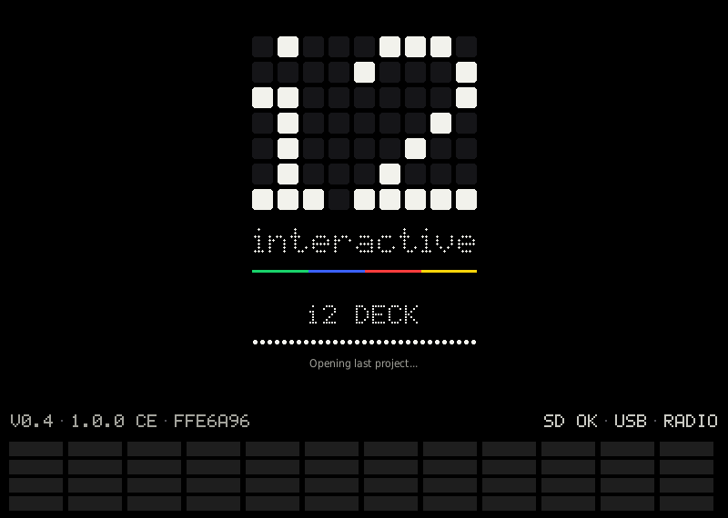
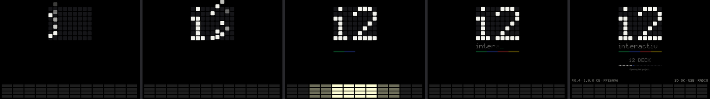
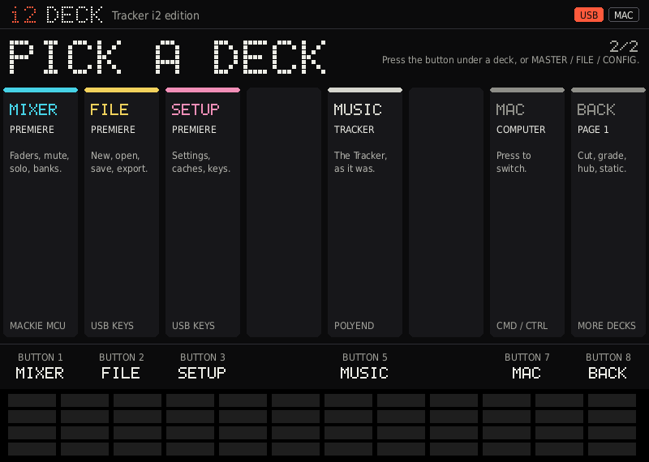
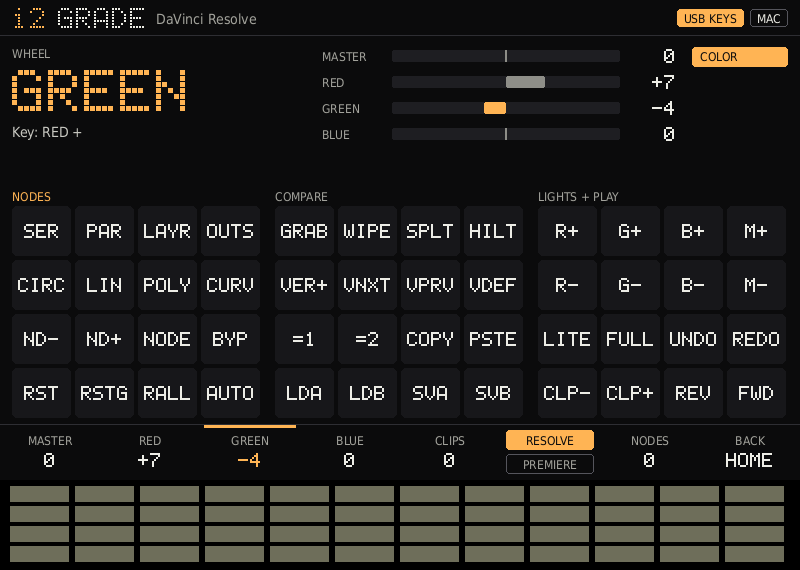
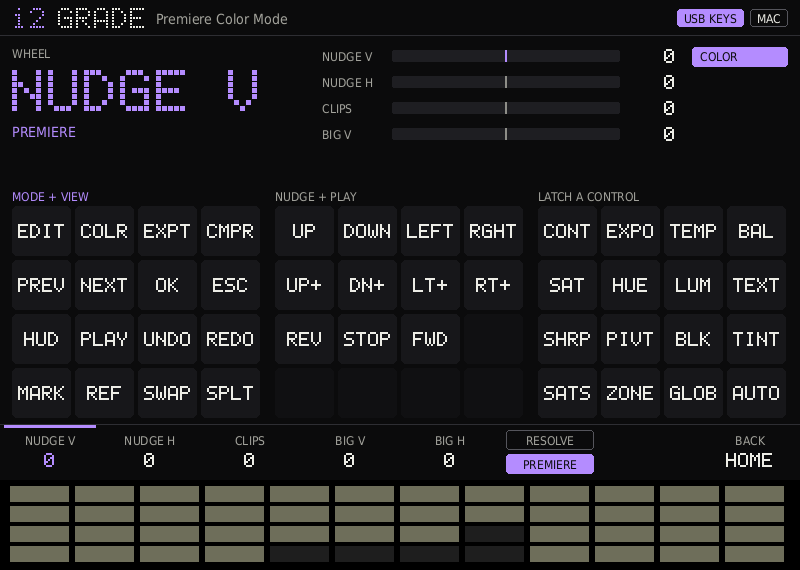
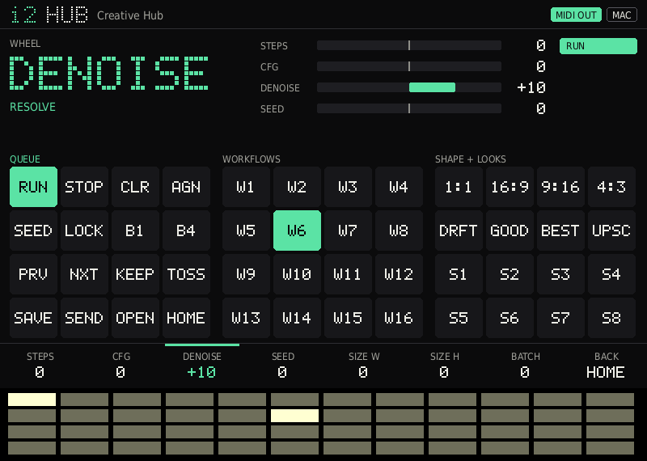
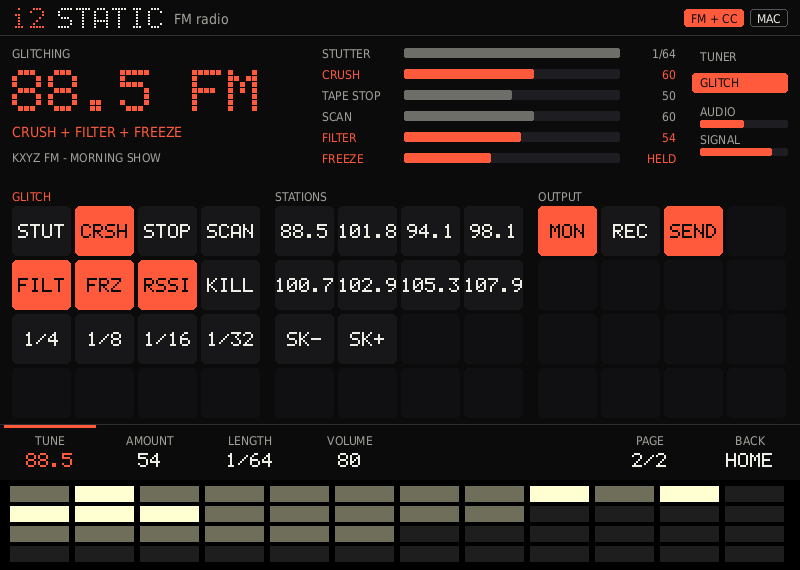
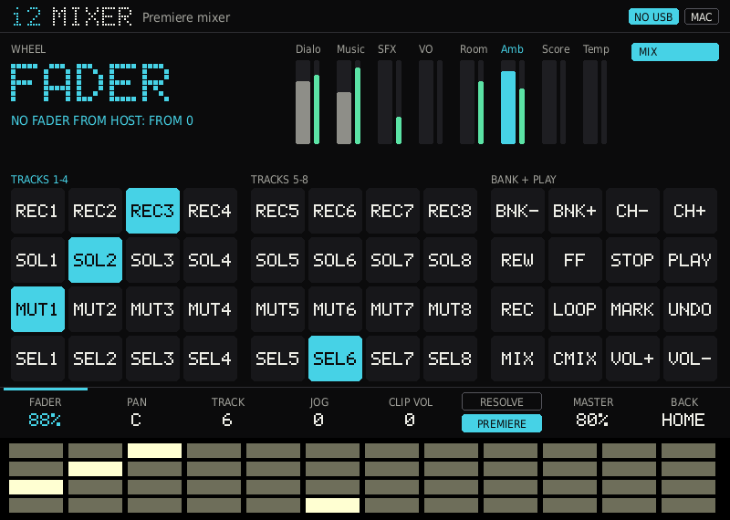
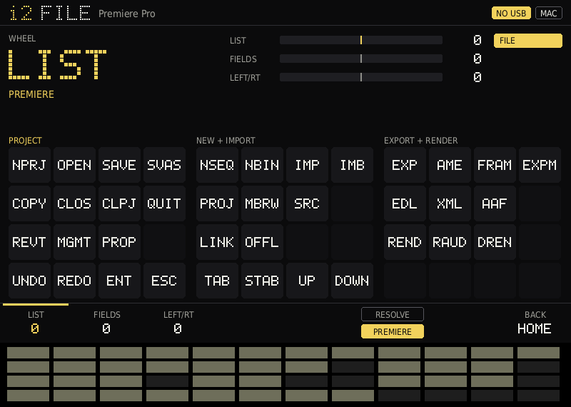
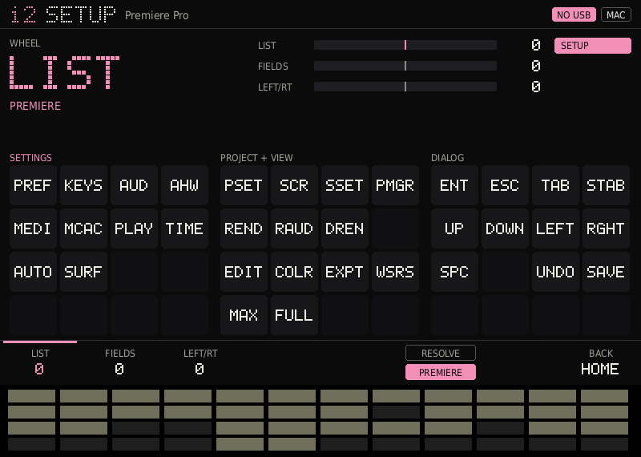

# Tracker i2 edition

Custom firmware for the **original Polyend Tracker** by [i2 interactive](https://i2interactive.com), built on Polyend's open-source [Tracker Community Edition](https://github.com/polyend/tracker-ce).

It adds **i2 DECK**: a new full-screen interface that turns the Tracker into a control surface for video work. Plug it into a Mac or PC over USB-C and the 48 pads, the jog wheel and the screen become a labelled keypad, a multi-function dial and a live display. Nothing is installed on the computer: the Tracker shows up as a standard USB keyboard next to its usual MIDI port. The Tracker itself is still there, one button away, and its File and Config screens are locked behind a button combo.


> **Status: v0.4.1 released (Nov 18, 2026).** v0.4.1 adds **i2 GRADE WHEELS** (Lift / Gamma / Gain / Offset, Contrast and Sat in Resolve from the jog wheel, through a small helper app; see [GRADE](#grade-davinci-resolve-or-premiere-color-mode)) and fixes GRADE's printer lights on Windows. v0.4.0 runs on Ian's Tracker, and its USB keys reach Windows over a data-rated USB-C cable. v0.3 added the Premiere Color Mode side of GRADE, STATIC's glitch section and the lock. v0.4 adds three decks on the MASTER, FILE and CONFIG buttons: **MIXER** (a Mackie Control surface for the Premiere and Resolve mixers), **FILE** and **SETUP**. It builds for all three Trackers, and every screen below is rendered from the real firmware code on a PC. i2 DECK only appears on the original Tracker (2020). See the [test checklist](#hardware-test-checklist).
>
> **Use a data-rated USB-C cable.** A charge-only cable powers the Tracker, but the deck shows **NO USB** and the computer sees nothing.

## Install

**Step-by-step guide: [INSTALL.md](INSTALL.md)**, from a stock Tracker to i2 DECK, with recovery steps.

The short version:
1. Back up your SD card.
2. Put the official Tracker 1.9.2 and CE 1.0 `.ptf` files from [polyend.com/downloads](https://polyend.com/downloads/) in `Firmware/` as a safety net.
3. Download `PolyendTracker_i2_<version>.ptf` from the [Releases page](https://github.com/i2interactive/tracker-i2-edition/releases). (Test builds of every change are on the [Actions tab](https://github.com/i2interactive/tracker-i2-edition/actions/workflows/build.yml); you need to be signed in to GitHub for those.)
4. Copy `PolyendTracker_i2_<version>.ptf` to `Firmware/` without renaming it.
5. On the Tracker, run **Config > Firmware > Firmware update**. From v0.3 on, Config is locked, and from v0.4 the Config button in i2 DECK opens the SETUP deck. So: on the i2 DECK home screen, **unlock** (hold Shift + Rec for 2 seconds, see [the lock](#the-lock)), press **PATTERN** to get to the normal Tracker, **then Config**.
6. The Tracker restarts into i2 DECK.

## Boot splash

The original Tracker starts on an i2 DECK splash instead of Polyend's logo and loading bar. The big dotted i2 settles into its 5x7 grid dot by dot, the four i2 colours sweep under it (and across the pads), "interactive" types in, then i2 DECK, the versions and a dot progress bar that follows the real project load. The status line only reports what is true: **SD OK**, **USB** (a computer has set up the USB port; **NO USB** with a charge-only cable) and **RADIO** (the FM receiver answered).





- It plays inside the ~2 seconds the Tracker already spends opening the last project, so it adds no boot time. A big project keeps the finished splash up while the bar fills.
- A Tracker that starts in MUSIC (`boot=music` with `lock=off`) shows a shorter version. `splash=short` or `splash=off` (still, no motion and no pad sweep) in `settings.txt` change it.
- Before the splash starts, the screen shows the mark's empty dot grid, never the Polyend logo. What can't change: the bootloader's own screen while it flashes a firmware file (Config > Firmware update or the pinhole recovery). It lives on a separate chip.
- Tracker+ and Mini keep Polyend's start screen.

## How i2 DECK works

The Tracker starts on the **home screen**. The eight buttons under the screen pick what is above them: a deck, **MUSIC** (the normal Tracker), or the **Mac / Win** switch. The home screen has two pages: **button 8 (MORE / BACK)** turns it. Page 1 holds CUT, GRADE, HUB and STATIC; page 2 holds MIXER, FILE and SETUP. HOME from a deck goes back to that deck's page.



**The big Tracker buttons in i2 DECK** (locked or unlocked):

| Button | Opens |
|---|---|
| NOTE | CUT |
| INSTRUMENT | GRADE |
| FX1 | HUB |
| FX2 | STATIC |
| MASTER | MIXER |
| FILE | FILE |
| CONFIG | SETUP (the settings deck) |
| PATTERN | MUSIC: the normal Tracker |
| Params, Performance, Sample Load / Play / Edit / Rec, Song | nothing |

Every deck uses the same layout:

| Part of the screen | What it shows | What you press |
|---|---|---|
| **Key map** (bottom half) | The 48 pads as three 4x4 blocks, each key with its full name. Short names are big; longer ones wrap to two or three lines, and a word too long for the pad is split with a hyphen | The pad in the same position. Lit pads have a job; a held pad lights up on screen, and its name and the shortcut it sent appear in the live band |
| **Dial strip** (bottom edge) | Jobs for the jog wheel, PAGE and HOME | Screen buttons pick the wheel's job. **Button 8 is HOME in every deck.** In a deck with pages, button 7 turns the page |
| **Live band** (top) | The wheel's current job, the name of the last key pressed, and how far each dial has moved | |

- **Shift** adds Shift to any pad or wheel step. In a deck, holding Shift also shows how full the screen is in the top bar (`Screen 6200 / 8172 B`).
- **If the screen runs out of display memory** (a deck file with very long names, say), the right-hand block goes back to short codes, then the middle one, and the deck flashes SCREEN FULL: SHORT NAMES. Turning the page tries full names again.
- **Play, the arrows, Delete, Copy and Insert** send Space, the arrow keys, Backspace, Copy and Paste in the keyboard decks.
- **The deck buttons work from the home screen or any deck.** In the normal Tracker every big button works as usual, except File and Config while locked: there they **bring you back to i2 DECK** (see [The lock](#the-lock)).
- **Mac or Windows:** button 7 on the home screen. It swaps Cmd for Ctrl and Option for Alt, and is remembered.

### The lock

The Tracker shows only the i2 DECK home screen, its decks and MUSIC (the normal pattern, instrument, sample and song screens). Polyend's **File** (project browser) and **Config** screens are locked:

- In i2 DECK, File and Config open the FILE and SETUP decks, never Polyend's screens (locked or not). PATTERN opens the normal Tracker.
- In the Tracker's own screens, File and Config take you to the i2 DECK home screen, which shows **LOCKED**. This is also the way back to the deck. Unlocked, they open Polyend's File and Config as usual, and Config > i2 > Deck comes back.
- A locked Tracker always starts in i2 DECK (`boot=music` only applies when the lock is off).

**To reach Polyend's Config (and Firmware update):** in i2 DECK (home screen or any deck), **hold Shift and Rec together for 2 seconds** (bottom row of the right-hand buttons, next to each other). The home screen shows **UNLOCKED UNTIL RESTART**, and an UNLOCKED chip stays in the top bar. Then press **PATTERN** (or MUSIC) to get to the normal Tracker, and press **Config**: Config and **Config > Firmware > Firmware update** work. File works there too. Hold Shift + Rec for 2 seconds again in i2 DECK to lock without restarting.

**To turn the lock off for good:** change `lock=on` to `lock=off` in `i2/Deck/settings.txt` on the SD card.

There is no way to get stuck: PATTERN always leads from i2 DECK to the Tracker, the combo always works in i2 DECK, `lock=off` on the card always works, and the recessed pinhole recovery on the bottom of the Tracker is in the bootloader, which firmware can't touch (see [INSTALL.md](INSTALL.md#part-7-if-something-goes-wrong)).

### CUT: Premiere Pro


Uses Premiere's **default shortcuts**, so nothing is imported into Premiere. Two pages:

- **EDIT:** shuttle (J K L), in/out marks, add edit, ripple delete, lift/extract, insert/overwrite, trims, nudge, tools, timeline navigation, markers, zoom, track height, render.
- **CLIPS:** clipboard, group/link/enable, speed, gain, subclip, transitions, clip volume, import/export/save, and the panel shortcuts.
- **Wheel:** frame step, 5-frame jump, cut to cut, zoom, marker to marker, clip volume.

### GRADE: DaVinci Resolve or Premiere Color Mode



GRADE is one deck with two apps. **Screen button 6** switches between **RESOLVE** and **PREMIERE**; the lit half of the switch shows which one is live, and the choice is kept in `settings.txt` (`grade=resolve` or `grade=premiere`). Each side has its own key map and wheel jobs, and Mac/Win works on both.

**RESOLVE** uses the colour page's **default shortcuts**: add serial/parallel/layer/outside nodes, add windows, step through nodes, bypass, resets, grab still, wipe, split screen, versions, memories, and copy the grade from one or two clips back. **The wheel trims Offset** through Resolve's printer lights: press **Printer Lights** (LITE in the deck file; Color > Printer Light Hotkeys; Resolve switches them off again after a restart or a project change), then pick OFS ALL, OFS RED, OFS GRN or OFS BLU on the dial strip and turn. Each click is one printer point. The deck flashes PRINTER LIGHTS ON / OFF, and reminds you to press it if you turn the wheel while it thinks they're off. On Windows it turns Num Lock on by itself (with Num Lock off, the number pad sends arrows).

**Lift / Gamma / Gain: i2 GRADE WHEELS.** Resolve has no shortcuts and no MIDI for its colour wheels, so this one needs a small helper on the computer: [`tools/i2deck/grade-wheels`](../tools/i2deck/grade-wheels). Its `grade.txt` goes on the SD card and adds a **WHEELS** page to GRADE (screen button 7) that sends MIDI; the helper turns that into mouse drags on Resolve's own controls, after you show it where they are once (LEARN). Pick LIFT, GAMMA, GAIN or OFFSET on the pads; the dials drive that wheel's master, its colour balance (X and Y), Contrast and Sat. Works in Resolve and Resolve Studio, on Mac and Windows. Setup: the folder's README.



**PREMIERE** drives **Color Mode** (Premiere 27), which has its own keyboard layout, separate from Edit Mode:

- **MODE + VIEW:** jump to Edit, Color or Export mode (Window > Mode, Option/Alt + number), Comparison View (Cmd/Ctrl+3), previous/next clip (Up/Down), accept (Return), Esc, hold to hide the HUD (H), play, undo/redo, markers, plus reference marker, swap sides and split.
- **NUDGE + PLAY:** the arrow keys, which nudge a latched control like printer points, and the bigger Shift steps; J K L.
- **LATCH A CONTROL:** Contrast, Exposure, Temperature, Balance, Saturation, Hue, Lum Shift, Texture, Sharpness, Pivot, Black, Tint, Saturation Shift, Zones, Global, Auto Color.
- **Wheel:** latch a control (pad or click), then NUDGE V / NUDGE H move it. With nothing latched, NUDGE V and CLIPS step through clips.

Adobe has published only a few of Color Mode's default keys. Each line in `i2/Deck/gradepr.txt` is marked **[OK]** (checked in Adobe's docs), **[??]** (a guess: check it) or **[SET]** (no published default: assign the key in Premiere's Keyboard Shortcuts, Color Mode layout, or change the deck). The mode keys and the 16 latch keys need checking. Sources and details: [`tools/i2deck/PREMIERE_COLOR.md`](../tools/i2deck/PREMIERE_COLOR.md).

**No control surface route:** Premiere's built-in surface support (EUCON, Mackie) drives audio mixing and transport. Colour panels such as Tangent go through Tangent's own software. Neither path is open to the Tracker, so GRADE sends keys.

### HUB: i2 Creative Hub / ComfyUI



Drives the [i2 Creative Hub](https://github.com/i2interactive/i2-creative-hub) (1.22.0 or newer) over **USB MIDI**. In the Hub, open **Settings > MIDI controller (i2 DECK)**, turn it on (Chrome or Edge) and it finds the Tracker by itself; a MIDI light in the Hub's header blinks with every message.

- **QUEUE:** RUN the open tool, STOP the current render, CLR the queue, AGN runs the last tool again. SEED rolls a new seed, LOCK locks it, B1 / B4 set the batch. PRV / NXT step through results, KEEP stars one, TOSS drops it from the list, SAVE downloads it, SEND puts it into the open tool, OPEN shows it, HOME goes back to the index.
- **WORKFLOWS:** W1-W16 open tools (pick each slot in the Hub's Settings, or leave it on Auto).
- **SHAPE + LOOKS:** 1:1, 16:9, 9:16, 4:3; DRAFT / GOOD / BEST quality; UPSCALE IT sends the result to the upscaler; LOOK 1-8 turn the Hub's pinned looks on and off.
- **Wheel:** STEPS, CFG, DENOISE, SEED, SIZE W, SIZE H, BATCH on the open tool, with a big readout in the Hub.

Each pad is a note on channel 1 (its place on the 12x4 grid, 0-47, velocity 100 on press, note off on release); the wheel sends relative control changes 1-7 (65 = up, 63 = down). Any app with MIDI learn can use it too. The full map is in the Hub's [docs/MIDI.md](https://github.com/i2interactive/i2-creative-hub/blob/main/docs/MIDI.md). The Hub sends nothing back yet, so the pads don't light to show state.

### STATIC: the FM radio, heard and glitched



The original Tracker has an FM receiver. STATIC tunes it, **plays it** through the Tracker's outputs, and glitches it live. Headphones are the antenna, so keep a headphone cable plugged in.

**TUNER page**
- **Seek and step**, and the wheel tunes (Shift = 10x).
- **Eight station presets.** Shift + a station pad stores the current frequency.
- **Signal meter and scope**, plus the station's name when it broadcasts one.
- **MON** turns the radio sound on and off; the VOLUME dial sets its level (remembered).
- **SEND** turns signal strength into MIDI control change 20 on channel 16, so reception noise can drive a parameter in any MIDI app.
- **REC** opens the Tracker's sample recorder (pick **Radio** as its source) to sample the station.

**GLITCH page** (screen button 7 turns the page). Pads are momentary: hold to glitch, let go to return to the live station.

| Pad | Effect |
|---|---|
| STUT | Stutter: repeats the last note value at the project's tempo (wheel while held: 1/2 to 1/64) |
| 1/4 1/8 1/16 1/32 | Beat repeat at that length |
| CRSH | Bit crush plus sample-rate reduction |
| STOP | Tape stop: the pitch drops to nothing (amount = how fast) |
| SCAN | Hops the tuner around the station, with noise bursts between stations |
| FILT | Resonant low-pass sweep (amount = how closed) |
| FRZ | Freeze: holds a short grain; a latch, press again to let go |
| RSSI | Latch: signal strength closes the filter, so a fading station gets darker |
| KILL | Lets go of FRZ and RSSI |

**Turn the wheel while holding an effect** to set its strength (Shift = big steps). The AMOUNT dial sets the strength of the last effect touched, LENGTH sets the stutter length, and VOLUME sets the radio level. The live band shows each effect's strength, lit while engaged, plus the audio level and signal strength. Station presets and seek are on this page too.

**How the radio is processed:** the Si4703's audio goes through an analog switch into the codec's line input (the same route the sample recorder uses for Radio). The codec streams it into the audio engine with the line-in signal (`i2sStream -> stereoToMono -> mixer`). On the original Tracker that stream now passes through a small processor (`i2glitch::Core`) before the mixer. When nothing is engaged it passes the audio straight through and keeps 3 s of history in SDRAM. When an effect is engaged, it works on a mono mix (the tuner runs in mono) and costs well under 1% of the CPU per audio block. Outside STATIC, the line input goes back to the jack at the project's line-in volume, and the processor stays a pass-through.

### MIXER: the Premiere and Resolve mixers, as a Mackie Control surface (MASTER)



Premiere Pro and DaVinci Resolve both take a **Mackie Control (MCU)** surface over MIDI, so MIXER is one, over the Tracker's USB MIDI port. **Screen button 6** switches RESOLVE / PREMIERE (shared with FILE and SETUP: `app=` in `settings.txt`). Set the app up once:

- **Premiere:** Premiere Pro > Settings (Windows: Edit > Preferences) > **Control Surface** > Add > **Mackie**; select it, Edit, and pick the Tracker as MIDI Input Device and MIDI Output Device. It drives the **Audio Track Mixer**: faders, pan, mute, solo, banks, play and record.
- **Resolve:** Preferences > System > **Control Panels**: tick **Use MIDI Audio Console**, MIDI Protocol **MCU**, MIDI Input and Output: the Tracker. It drives the **Fairlight** mixer: faders, pan, rec arm, solo, mute, select, banks, transport, jog.

What the deck does:

- **Pads, blocks 1-2:** a channel strip per column for 8 tracks: REC (arm), SOLO, MUTE, SELECT. A lit pad is a lit LED in the app, so mute and solo states show on the pads.
- **Block 3:** BANK -8 / +8 and -1 / +1, rewind, fast forward, stop, play, record, cycle, marker, undo; the last row is plain keys: open the mixer (Premiere: Audio Track / Clip Mixer, Shift+6 / Shift+9; Resolve: Fairlight / Edit page) and clip volume +1 / -1 dB.
- **Wheel:** FADER moves the picked track's fader (any strip pad picks the track; so does the TRACK dial), PAN its pan, JOG the app's jog wheel, CLIP VOL the clip volume keys, MASTER the master fader. Shift = big steps.
- **Screen:** the eight strips with their names (when the app sends its display), fader positions and meters, all from the app. Without a position from the app, a fader starts at 0.

While i2 DECK is open, notes and control changes that arrive over USB go to the deck, not to the Tracker's instruments (Mackie hosts send their LEDs as notes). Protocol details, sources and what's verified: [`tools/i2deck/APP_DECKS.md`](../tools/i2deck/APP_DECKS.md).

### FILE: new, open, save, import, export (FILE)



Keyboard shortcuts for the File menu and export. **Premiere:** new project / sequence / bin, open, save / save as / save a copy, close, quit, import (and from the Media Browser), properties, Export Media, send to Media Encoder, export frame, render. **Resolve:** Project Manager, save / save as, import media / timeline, export project / timeline, Media page, Deliver page, quick export, render queue. The wheel moves through dialogs (Down / Up, Tab / Shift+Tab, Left / Right). Screen button 6 switches RESOLVE / PREMIERE.

### SETUP: settings, caches and keys (CONFIG)



The settings deck (named SETUP to fit the home tile). **Premiere:** every Settings / Preferences page (General, Audio, Audio Hardware, Media, Media Cache, Playback, Timeline, Auto Save, Control Surface), Keyboard Shortcuts, Project Settings, Scratch Disks, Sequence Settings, Project Manager, render and delete render files, Window > Mode, workspace reset. **Resolve:** Preferences, Keyboard Customization, Project Settings, Project Manager, Timeline Settings, render cache modes and delete, proxy / optimized media, and the seven pages. A dialog block (Enter, Esc, Tab, arrows, Space) and the same dialog wheel as FILE.

**One-time setup:** Premiere has no default keys for its settings pages, and some File and Resolve commands have none either. Those pads are marked `[SET]` in the deck files and send **Control + Option + Shift + a letter** (Windows: Ctrl + Alt + Shift). Give each command that key in Premiere's Keyboard Shortcuts or Resolve's Keyboard Customization. `[??]` keys are guesses to check. The full list: [`tools/i2deck/APP_DECKS.md`](../tools/i2deck/APP_DECKS.md).

### Making your own deck

The first time a deck opens, it is written to the SD card as `i2/Deck/cut.txt`, `grade.txt`, `hub.txt`, `static.txt`, and for the decks with a Resolve / Premiere switch `mixerres.txt` / `mixerpr.txt`, `fileres.txt` / `filepr.txt`, `setupres.txt` / `setuppr.txt`. Edit the file on a computer and reopen the deck. No new firmware is needed. Delete the file to get the built-in version back.

```text
DECK CUT
REV 1                          (optional: see below)
APP Premiere Pro
LINK KEYS                      (KEYS, MIDI, RADIO or MCU)
COLOR 7FB2FF
PAGE EDIT
BLOCK 1 PLAY + MARK            (blocks 1-3, left to right)
K REV  Reverse | J             (next pad in the block: code, name | shortcut)
K CLR  Clear In/Out | OPT+X | CTRL+SHIFT+X (optional separate Windows shortcut)
K -                            (leave a pad empty)
DIAL 1 FRAME | RIGHT | LEFT    (wheel job: name | clockwise | anticlockwise)
```

- Up to 4 pages, 16 keys per block, 7 dials per page (6 in a deck with more than one page, where button 7 turns the page; in GRADE, MIXER, FILE and SETUP, button 6 is the app switch). Codes are up to 4 characters, names up to 23. The name is what the key shows, written the way you want it shown: mixed case fits best (about 8 letters a line, 3 lines). The code is shown only for a key with no name.
- GRADE has two files: `grade.txt` (Resolve) and `gradepr.txt` (Premiere).
- **REV:** the built-in decks carry a version. When new firmware brings a newer GRADE or STATIC deck, the old file on the card is kept as `<name>-old.txt` (for example `static-old.txt`) and replaced, and the deck flashes a note. Copy your edits across from the old file. v0.3 does this once for `grade.txt` and `static.txt`; v0.5 does it once for every deck, to bring in the full key names (the GRADE file with the WHEELS page is the exception: copy the new `tools/i2deck/grade-wheels/grade.txt` to the card by hand).
- **MIXER actions** (`LINK MCU`; pads with a shortcut still send keys): strip buttons `@REC1`-`@REC8 @SOLO1`-`8 @MUTE1`-`8 @SEL1`-`8`, `@BANK- @BANK+ @CH- @CH+ @FLIP @REW @FF @STOP @PLAY @RECORD @CYCLE @MARKER @UNDO @SAVE @NUDGE @READ @WRITE @TOUCH @LATCH`, any Mackie note as `@N<0-127>`, and the dial jobs `@FADER @MASTER @PAN @STRIP @JOG`.
- **STATIC actions** (instead of a shortcut): `@SEEK+ @SEEK- @STEP+ @STEP- @P1`-`@P8 @SEND @RECORDER @MON`, the glitches `@STUTTER @CRUSH @STOP @SCAN @FILTER @FREEZE @RSSI @KILL`, beat repeats `@R2 @R4 @R8 @R16 @R32 @R64`, and the dial jobs `@TUNE @AMOUNT @LENGTH @VOLUME`.
- **Modifiers:** `CMD` (Cmd on Mac, Ctrl on Windows), `CTRL`, `SHIFT`, `OPT` or `ALT`, `WIN`.
- **Keys:** A-Z, 0-9, F1-F24, SPACE, ENTER, ESC, TAB, BKSP, DEL, INS, HOME, END, PGUP, PGDN, UP, DOWN, LEFT, RIGHT, BACKSLASH, the symbols `- = [ ] ; ' , . /` and the grave accent, and the number pad as KP0-KP9, KPPLUS, KPMINUS, KPENTER.

### Settings

`i2/Deck/settings.txt` on the SD card, written by the Tracker:

```text
os=mac          mac or win
boot=deck       deck or music (music only works with lock=off)
lock=on         on or off: the File / Config lock
splash=full     full, short or off: the boot splash
grade=resolve   resolve or premiere: GRADE's app
app=premiere    resolve or premiere: MIXER, FILE and SETUP's app
freq=981        STATIC's station, in 100 kHz
vol=80          STATIC's radio volume, 0-100
p1=885 ... p8=1079   station presets
```

### Hardware test checklist

v0.5 (full key names):
1. **Names.** Open each deck and page. Every key shows its full name, nothing runs off a pad or overlaps the next one, and the names sit in the middle of their pads. Short names (Undo, Stop) are big and bold; longer ones are smaller.
2. **Right-hand block.** The right-hand block (MOVE + VIEW in CUT) is in the right place, not drawn over the left-hand block. It's drawn with a display-chip shift, new in v0.5.
3. **Screen memory.** Hold Shift in CUT page 1 and in GRADE (Resolve): note the `Screen ... / 8172 B` number in the top bar for each. Expected around 5000-6500. If SCREEN FULL: SHORT NAMES flashes on a built-in deck, note which deck and page.
4. **Live band.** Press a pad: the live band shows its name and the shortcut, e.g. `Key: Ripple Delete   Opt+Delete`.
5. **Deck files.** The first time each deck opens it flashes NEW DECK: OLD ONE SAVED AS -OLD, and `<name>-old.txt` appears on the card. For GRADE with the WHEELS page, copy the new `grade.txt` from `tools/i2deck/grade-wheels/` to the card first (REV 10).

v0.2 (passed on Ian's Tracker, Nov 14): boots to i2 DECK, USB keys reach Windows over a data-rated cable.

Boot splash (after v0.4):
1. **Power on.** Note everything the screen shows from switch-on: does the backlight show anything before the empty dot grid (bootloader)? No Polyend logo anywhere. The dots settle into i2, the colour band sweeps, "interactive" types in, then i2 DECK, the bar and the status line. Smooth, no flashing, no black blink between the grid and the animation.
2. **Pads.** One soft sweep across the 48 pads, left to right with the colour band, then all dark before the home screen.
3. **Status line.** With a data cable to a computer: SD OK, USB, RADIO. With no cable (or a charge-only one): NO USB. Does USB come up during the splash, or only later?
4. **Timing.** Boot to the i2 DECK home takes as long as before (about 2 s on the splash with a small project). With a big project the finished splash waits and the bar keeps moving. The bar ends full, then the home screen appears.
5. **Versions.** Bottom left reads V0.4, the CE version and the build id of the .ptf.
6. **Settings.** `splash=short`: quicker version. `splash=off`: the finished splash, still, no pad sweep. `lock=off` + `boot=music`: the short version, then MUSIC. Turn the Mac/Win switch: `splash=` stays in `settings.txt`.
7. **No card.** Boot without the SD card: "Please insert SD card" shows as before; insert it and the splash carries on.

v0.4 (use a data-rated USB-C cable):
1. **Buttons.** From the home screen and from inside a deck, locked and unlocked: NOTE, INSTRUMENT, FX1, FX2, MASTER, FILE, CONFIG open CUT, GRADE, HUB, STATIC, MIXER, FILE, SETUP. PATTERN opens the Tracker. Params, Performance, the four Sample buttons and Song do nothing.
2. **Home page 2.** Button 8 (MORE) shows MIXER, FILE, SETUP on buttons 1-3; button 8 (BACK) returns. HOME from MIXER lands on page 2.
3. **Route to Polyend's Config.** Locked: in the Tracker (PATTERN), Config brings you back to i2 DECK (LOCKED). Unlock (Shift + Rec, 2 s), PATTERN, Config: Config opens, and Config > Firmware > Firmware update is there. Config > i2 > Deck comes back.
4. **MIXER in Premiere.** Add a Mackie control surface (see MIXER above) with the Tracker as input and output. With the Audio Track Mixer open: MUTE / SOLO pads toggle tracks, and the pads light when you mute in Premiere; the FADER wheel moves the picked track (does Premiere move the on-screen fader and send it back?); PAN; BANK; PLAY / STOP. Note which of REC, SELECT, CYCLE, MARK, UNDO, JOG, MASTER do anything. Does the Tracker's screen show track names and meters?
5. **MIXER in Resolve.** Preferences > System > Control Panels: Use MIDI Audio Console, MCU, the Tracker. On the Fairlight page, the same tests. Does the Tracker make any sound while Premiere or Resolve talk to it in i2 DECK? (It shouldn't.) And in MUSIC (the normal Tracker)?
6. **App switch.** Button 6 in MIXER, FILE or SETUP switches all three; GRADE keeps its own choice; both survive a restart.
7. **FILE and SETUP.** Try the OK keys (Save, Import, Export Media, Keyboard Shortcuts, Project Settings in Resolve). Assign a few `[SET]` keys in Premiere and try them; check the `[??]` ones.
8. **Nothing stuck.** Hold a pad and press MASTER / FILE / CONFIG / HOME: no key or MIDI note stays held.

v0.3:
1. **Update and lock.** After flashing, the Tracker boots to i2 DECK. Press each big Tracker button (Params through Song, Config and File included): nothing happens. PATTERN opens the normal Tracker. NOTE, INSTRUMENT, FX1 and FX2 open CUT, GRADE, HUB and STATIC, from the home screen and from inside another deck. MUSIC (button 5) opens the Tracker; Pattern, Song and Sample screens work; File and Config there bring you back to the i2 DECK home screen, which says LOCKED.
2. **Unlock combo.** On the home screen, hold Shift + Rec together for 2 seconds. "UNLOCKED UNTIL RESTART" appears and an UNLOCKED chip shows in the top bar. Config opens, including Config > Firmware. Hold them for 2 seconds again: LOCKED again. A short tap, or Shift or Rec alone, does nothing. Restart: locked again.
3. **lock=off.** Put `lock=off` in `settings.txt`: File and Config open straight away. Put `lock=on` back.
4. **GRADE switch.** In GRADE, button 6 switches RESOLVE / PREMIERE, the switch on screen follows, and the choice survives a restart. Resolve: LITE, then MASTER / RED on the wheel move the image (as in v0.2).
5. **Premiere Color Mode.** In Premiere 27, open a sequence in Color: PREV / NEXT and the CLIPS dial step clips; CMPR toggles Comparison View; click a control to latch it, then NUDGE V / H move it and OK accepts; HUD hides the HUD while held. Check EDIT / COLR / EXPT against Window > Mode, then assign the LATCH keys (see `tools/i2deck/PREMIERE_COLOR.md`) and try a few.
6. **Deck upgrade.** If the card has v0.2's `grade.txt` / `static.txt`, opening GRADE or STATIC flashes "NEW DECK: OLD ONE SAVED AS -OLD", and `grade-old.txt` / `static-old.txt` appear on the card.
7. **STATIC sound.** With headphones in, open STATIC: the station is audible. VOLUME changes the level; MON mutes and unmutes. If it's too quiet, raise **Gain** for Radio in the sample recorder (it's saved with the project), then reopen STATIC. Leave STATIC and play a project: the line input behaves as before (no radio, normal line-in volume).
8. **GLITCH.** Page 2: hold each effect pad (STUT, CRSH, STOP, SCAN, FILT) and let go; each one returns cleanly to the live station. The repeat pads lock to the project tempo. FRZ latches; RSSI darkens the sound as the signal drops (move the cable); KILL clears both. Turn the wheel while holding an effect. Listen for clicks, dropouts or a stuck effect, and check the Tracker still responds smoothly during SCAN (tuning blocks briefly).
9. **Everything from v0.2 still works:** CUT in Premiere, HUB MIDI, STATIC seek / presets / SEND / REC, Mac/Win switch, settings survive a restart.

### Testing on a computer

`tools/i2deck/host/` runs the firmware's own interface code on a PC with scripted input. It renders the screens (and the boot splash, `00*_boot_*.png`) to PNG, logs every key, note and radio command, fails if a key is left held, checks that every key name fits its pad, and checks each layer and the whole frame against the display chip's limits. Text is measured with the firmware's own font tables (Liberation Sans) and drawn with the Liberation Sans TTF (`fonts-liberation`).

```sh
sh tools/i2deck/host/run.sh        # needs g++, Python 3 and Pillow; output in tools/i2deck/host/out/
```

## Roadmap

- **Creative Hub:** the Hub listens to the HUB deck since Creative Hub 1.22.0; next, send state back to the Tracker's screen and pads
- **GRADE:** fill in Premiere Color Mode's real latch keys once checked; tune i2 GRADE WHEELS on real grades
- **MIXER / FILE / SETUP:** fill in the real Resolve and Premiere keys once checked; trim MIXER to what each host really answers
- **STATIC:** record the glitched output straight into a sample; per-effect presets
- **Decks:** pad + wheel combos, more decks, a deck picker for user files
- **i2 Arcade:** the KAGEMORI ports from v0.1 are parked in [`shelved/`](../shelved/) and can come back as a deck

## Where the i2 code lives

| Path | What |
|---|---|
| [`core/interface/i2Deck/i2DeckApp.*`](../core/interface/i2Deck/) | The interface: screens, navigation, deck file parser. No Tracker dependencies |
| [`core/interface/i2Deck/i2DeckDecks.cpp`](../core/interface/i2Deck/i2DeckDecks.cpp) | The built-in decks, as text (GRADE, MIXER, FILE and SETUP each have a Resolve and a Premiere file) |
| [`core/interface/i2Deck/i2Mcu.h`](../core/interface/i2Deck/i2Mcu.h) | MIXER's Mackie Control encoding (tested by the harness) |
| [`tools/i2deck/APP_DECKS.md`](../tools/i2deck/APP_DECKS.md) | Research notes: MIXER (Mackie Control in Premiere and Resolve), FILE and SETUP shortcuts, with sources |
| [`core/source/mtMidi.cpp`](../core/source/mtMidi.cpp), [`core/include/Platform.h`](../core/include/Platform.h) | i2 DECK takes the USB MIDI input while it is open (pitch bend, pressure and sysex added for MIXER), and gives it back |
| [`core/interface/i2Deck/i2Splash.*`](../core/interface/i2Deck/) | The boot splash (no Tracker dependencies; rendered and checked by the harness) |
| [`core/libs/NewDisplay/startScreen.cpp`](../core/libs/NewDisplay/startScreen.cpp), [`display.cpp`](../core/libs/NewDisplay/display.cpp), [`core/interface/core/interfaceMisc.cpp`](../core/interface/core/interfaceMisc.cpp) | Original Tracker: the start screen draws the splash, the power-on and font-load frames show its dot grid, the start screen's ticks drive it and the pad sweep. Polyend's logo is left out |
| [`core/interface/i2Deck/i2Glitch.*`](../core/interface/i2Deck/) | STATIC's glitch processor (no Tracker dependencies; tested by the harness) |
| [`core/AudioEngine/AudioEffectI2Glitch.*`](../core/AudioEngine/) | Puts the glitch processor in the line-in stream (`AudioInput`, `audioEngine::connectInputToMixer`). Original Tracker only |
| [`core/interface/core/interface.cpp`](../core/interface/core/interface.cpp) | The lock: in the Tracker's screens, `switchModuleByButton` sends File and Config to i2 DECK while locked |
| [`tools/i2deck/PREMIERE_COLOR.md`](../tools/i2deck/PREMIERE_COLOR.md) | Research notes: Premiere Color Mode shortcuts and control surfaces |
| [`core/interface/i2Deck/fI2Deck.cpp`](../core/interface/i2Deck/fI2Deck.cpp) | The Tracker module: input (which big button opens which deck), USB keyboard, MIDI in and out, radio, SD card |
| [`core/interface/i2Deck/i2Canvas.*`](../core/interface/i2Deck/) | Drawing on the FT812 display chip |
| [`core/interface/i2Deck/i2DotFont.*`](../core/interface/i2Deck/) | The 5x7 dot-matrix face, generated at start-up in three sizes |
| [`tools/i2deck/host/`](../tools/i2deck/host/) | The PC test harness |
| [`shelved/`](../shelved/) | v0.1 Controller mode and i2 Arcade. Not built |
| [`platforms/mk66/source/UsbKeyboardImpl.*`](../platforms/mk66/source/) | USB keyboard driver for the original Tracker |
| [`platforms/mk66/3rdparty/teensy_core/usb_desc.h`](../platforms/mk66/3rdparty/teensy_core/usb_desc.h) | USB layout. Keyboard is interface 3, RawHID moves to 4. Build with `-DI2_NO_USB_KEYBOARD` for stock |
| [`core/include/Platform.h`](../core/include/Platform.h) | `UsbKeyboard` interface and the radio's signal strength |
| [`core/libs/NewDisplay/display.cpp`](../core/libs/NewDisplay/display.cpp) | Loads the dot-matrix fonts next to the Tracker's own |
| [`.github/workflows/build.yml`](workflows/build.yml) | CI. Builds are named `i2_<commit>` |

## Hardware notes: original Tracker (MK66)

| Part | What it is | Notes |
|---|---|---|
| CPU | NXP Kinetis MK66FX1M0, Cortex-M4F, 180 MHz | About ⅓ the speed of Tracker+ / Mini |
| Flash | 1 MB | New code has to stay lean. The CI log prints the size of every build |
| RAM | 256 KB internal, about 87 KB free | |
| SDRAM | 16 MB, about 1.1 MB free | i2 DECK borrows the shared 768 KB scratch area; STATIC's glitch history takes 256 KB of its own |
| Display | 7" 800×480, FTDI FT812 | 65 display controls, 8 KB of display memory each |
| Input | 48 backlit pads (4×12), 33 buttons, jog wheel | Pad lights are one color, brightness only |
| Audio | SGTL5000 codec, mono line in, mic in, stereo out | Mono samples on this model |
| Radio | Si4703 FM **receiver** with RDS | Receive only. The headphone cable is the antenna. Its audio reaches the codec's line input through an analog switch |
| I/O | MIDI in/out (minijack), USB-C MIDI, microSD | No Wi-Fi, Bluetooth or USB audio |

## Staying in sync with Polyend

This repo is a **fork**: a copy of Polyend's repo that keeps a link back to it. When Polyend pushes updates, GitHub shows "This branch is N commits behind polyend/tracker-ce" on the repo page. Click **Sync fork** to pull them in. If Polyend changed a file that i2 also changed, GitHub asks for the conflict to be fixed first.

The i2 changes stay in their own files where possible, and this README lives in `.github/` so Polyend's `README.md` never conflicts.

## Build

GitHub Actions builds all three models on every push to `main` and on every pull request to `main`. To build locally, install GNU Arm Embedded Toolchain 10.3-2021.10 and run `make original`. The file appears as `build/PolyendTracker_*.ptf`. Polyend's full developer docs are in [`README.md`](../README.md) and [`docs/`](../docs/).

## License

MIT, inherited from Polyend's Tracker CE, plus Polyend's restriction on selling a wholesale commercial clone of the full Tracker firmware. The precompiled `synth/lib/*.a` files have their own license. See [`LICENSE`](../LICENSE).

Not affiliated with or endorsed by Polyend.

## Contributing upstream

Polyend's PR check rejects AI `Co-authored-by` trailers. Strip them before opening a PR to `polyend/tracker-ce`.
