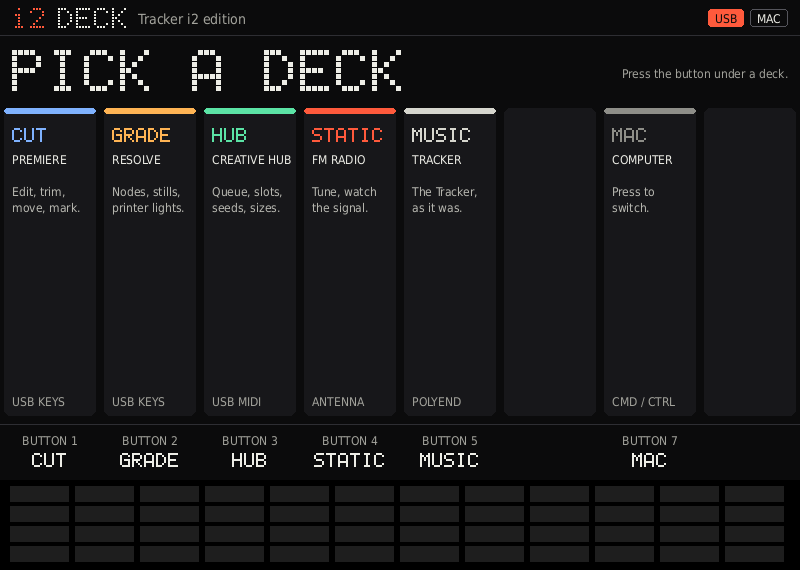
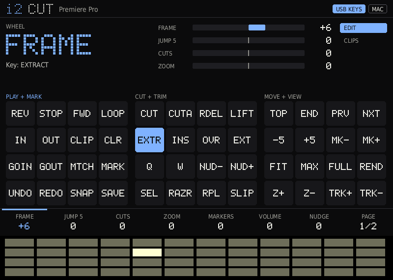
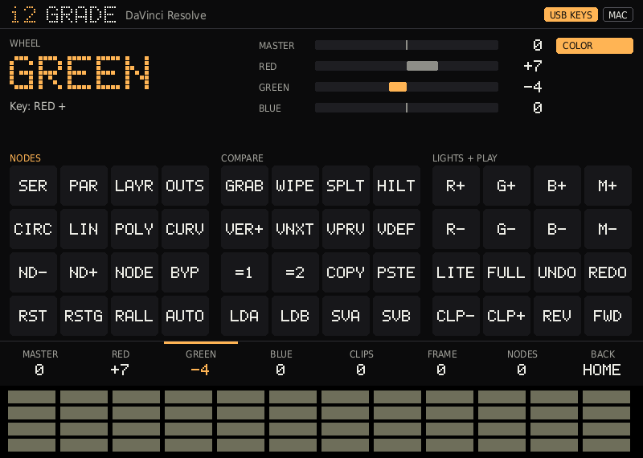
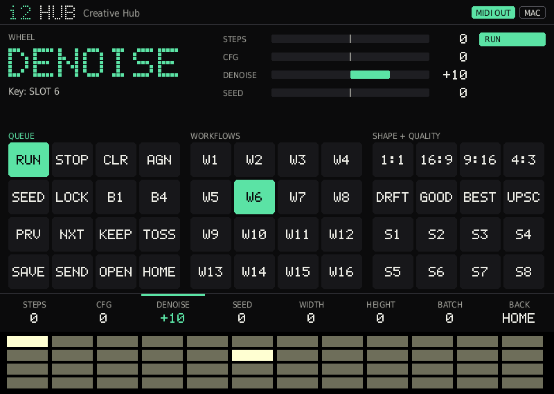
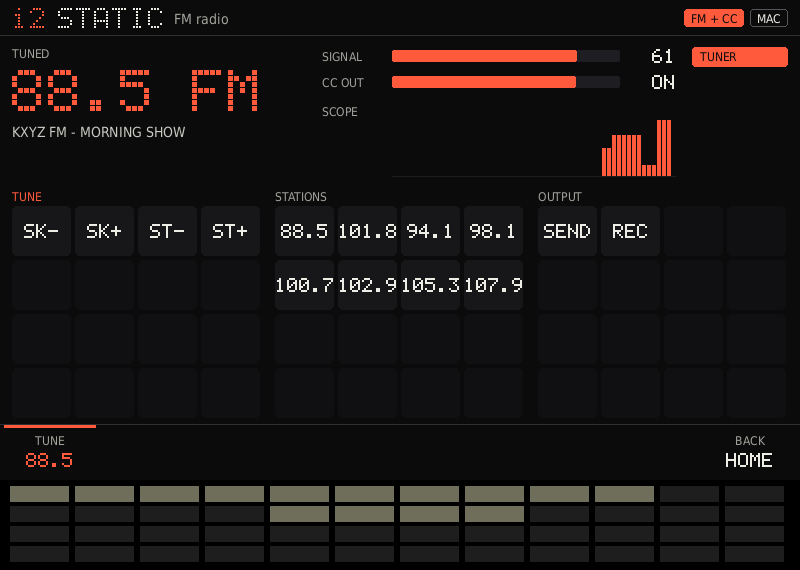

# Tracker i2 edition

Custom firmware for the **original Polyend Tracker** by [i2 interactive](https://i2interactive.com), built on Polyend's open-source [Tracker Community Edition](https://github.com/polyend/tracker-ce).

It adds **i2 DECK**: a new full-screen interface that turns the Tracker into a control surface for video work. Plug it into a Mac or PC over USB-C and the 48 pads, the jog wheel and the screen become a labelled keypad, a multi-function dial and a live display. Nothing is installed on the computer: the Tracker shows up as a standard USB keyboard next to its usual MIDI port. The Tracker itself is still there, one button away.



> **Status: v0.2, not yet tested on hardware.** It builds for all three Trackers and every screen below is rendered from the real firmware code on a PC, but nobody has flashed it yet. i2 DECK only appears on the original Tracker (2020). See the [test checklist](#hardware-test-checklist).

## Install

**Step-by-step guide: [INSTALL.md](INSTALL.md)**, from a stock Tracker to i2 DECK, with recovery steps.

The short version:
1. Back up your SD card.
2. Put the official Tracker 1.9.2 and CE 1.0 `.ptf` files from [polyend.com/downloads](https://polyend.com/downloads/) in `Firmware/` as a safety net.
3. Download the newest **polyend-tracker-ce-firmware** artifact from the [Actions tab](https://github.com/i2interactive/tracker-i2-edition/actions/workflows/build.yml). You need to be signed in to GitHub.
4. Copy `PolyendTracker_i2_<version>.ptf` to `Firmware/` without renaming it.
5. On the Tracker, run **Config > Firmware > Firmware update**.
6. The Tracker restarts into i2 DECK.

## How i2 DECK works

The Tracker starts on the **home screen**. The eight buttons under the screen pick what is above them: a deck, **MUSIC** (the normal Tracker), or the **Mac / Win** switch.

Every deck uses the same layout:

| Part of the screen | What it shows | What you press |
|---|---|---|
| **Key map** (bottom half) | The 48 pads as three 4x4 blocks, each key with a short code | The pad in the same position. Lit pads have a job; a held pad lights up on screen and its full name appears in the live band |
| **Dial strip** (bottom edge) | Up to seven jobs for the jog wheel, plus PAGE | Screen buttons 1-7 pick the wheel's job. Button 8 turns the page |
| **Live band** (top) | The wheel's current job, the name of the last key pressed, and how far each dial has moved | |

- **Shift** adds Shift to any pad or wheel step.
- **Shift + button 8** goes back to the home screen.
- **Play, the arrows, Delete, Copy and Insert** send Space, the arrow keys, Backspace, Copy and Paste in the keyboard decks.
- **Any Tracker button** (Pattern, Song, Config...) opens that Tracker screen straight away. Come back with **Config > i2 > Deck**.
- **Mac or Windows:** button 7 on the home screen. It swaps Cmd for Ctrl and Option for Alt, and is remembered.

### CUT: Premiere Pro



Uses Premiere's **default shortcuts**, so nothing is imported into Premiere. Two pages:

- **EDIT:** shuttle (J K L), in/out marks, add edit, ripple delete, lift/extract, insert/overwrite, trims, nudge, tools, timeline navigation, markers, zoom, track height, render.
- **CLIPS:** clipboard, group/link/enable, speed, gain, subclip, transitions, clip volume, import/export/save, and the panel shortcuts.
- **Wheel:** frame step, 5-frame jump, cut to cut, zoom, marker to marker, clip volume, nudge.

### GRADE: DaVinci Resolve



Resolve's colour page, on its **default shortcuts**: add serial/parallel/layer/outside nodes, add windows, step through nodes, bypass, resets, grab still, wipe, split screen, versions, memories, copy grade from one or two clips back.

**The wheel grades.** Press **LITE** once to switch on Resolve's printer lights, then pick MASTER, RED, GREEN or BLUE on the dial strip and turn. Each click is one printer point. This is as close as a keyboard can get: Resolve has no shortcuts for the colour wheels themselves, so lift/gamma/gain stay on the mouse.

### HUB: i2 Creative Hub / ComfyUI



Sends **USB MIDI** instead of keys: each pad is a note (pad number 0-47, channel = page), and the wheel sends relative control changes 1-7 (65 = up, 63 = down). The labels (queue, interrupt, seed, workflow slots, sizes, quality) are names for those notes.

**One-way for now:** the Creative Hub does not listen for MIDI yet, so this deck does nothing until that side is written. Any app with MIDI learn can use it today.

### STATIC: the FM radio



The original Tracker has an FM receiver. STATIC tunes it and treats the signal as a control source:

- **Seek and step**, and the wheel tunes (Shift = 10x).
- **Eight station presets.** Shift + a station pad stores the current frequency.
- **Signal meter and scope**, plus the station's name when it broadcasts one.
- **SEND** turns signal strength into MIDI control change 20 on channel 16, so reception noise can drive a parameter in any MIDI app.
- **REC** opens the Tracker's sample recorder, which can record the radio.

Not in this version: hearing the radio while in STATIC, and audio glitch effects. The headphone cable is the antenna.

### Making your own deck

The first time a deck opens, it is written to the SD card as `i2/Deck/cut.txt`, `grade.txt`, `hub.txt` or `static.txt`. Edit the file on a computer and reopen the deck. No new firmware is needed. Delete the file to get the built-in version back.

```text
DECK CUT
APP Premiere Pro
LINK KEYS                      (KEYS, MIDI or RADIO)
COLOR 7FB2FF
PAGE EDIT
BLOCK 1 PLAY + MARK            (blocks 1-3, left to right)
K REV  REVERSE  | J            (next pad in the block: code, name | shortcut)
K CLR  CLEAR IO | OPT+X | CTRL+SHIFT+X     (optional separate Windows shortcut)
K -                            (leave a pad empty)
DIAL 1 FRAME | RIGHT | LEFT    (wheel job: name | clockwise | anticlockwise)
```

- Up to 4 pages, 16 keys per block, 7 dials per page. Codes are up to 4 characters, names up to 10.
- **Modifiers:** `CMD` (Cmd on Mac, Ctrl on Windows), `CTRL`, `SHIFT`, `OPT` or `ALT`, `WIN`.
- **Keys:** A-Z, 0-9, F1-F24, SPACE, ENTER, ESC, TAB, BKSP, DEL, INS, HOME, END, PGUP, PGDN, UP, DOWN, LEFT, RIGHT, BACKSLASH, the symbols `- = [ ] ; ' , . /` and the grave accent, and the number pad as KP0-KP9, KPPLUS, KPMINUS, KPENTER.

### Starting in the Tracker instead

i2 DECK is the start-up screen. To start in the normal Tracker, edit `i2/Deck/settings.txt` on the SD card and change `boot=deck` to `boot=music`. i2 DECK is then at **Config > i2 > Deck**.

### Hardware test checklist

1. The Tracker boots to the i2 DECK home screen. Dot-matrix text is sharp and nothing flickers.
2. Button 5 (MUSIC) opens the Tracker; a project loads and plays; Config > i2 > Deck comes back.
3. CUT: pads light where a key exists, a held pad lights on screen, and in a text editor the IN pad types `i`.
4. In Premiere, with the timeline focused: J K L, add edit, ripple delete, and each wheel job.
5. Mac/Win switch: add edit sends Cmd+K on Mac and Ctrl+K on Windows.
6. GRADE in Resolve: LITE, then the wheel on MASTER and RED changes the image.
7. HUB: a MIDI monitor shows notes and control changes.
8. STATIC: seek finds stations, the signal meter moves, a preset stores and recalls, REC opens the recorder.
9. Settings and presets survive a restart. `boot=music` starts in the Tracker.

### Testing on a computer

`tools/i2deck/host/` runs the firmware's own interface code on a PC with scripted input. It renders the screens to PNG, logs every key, note and radio command, fails if a key is left held, and checks each layer and the whole frame against the display chip's limits.

```sh
sh tools/i2deck/host/run.sh        # needs g++, Python 3 and Pillow; output in tools/i2deck/host/out/
```

## Roadmap

- **Creative Hub:** make the Hub listen to the HUB deck (Web MIDI), then send state back to the Tracker's screen
- **GRADE:** a small helper app for true lift/gamma/gain control
- **STATIC:** radio audio monitoring, capture and glitch effects
- **Decks:** pad + wheel combos, more decks, a deck picker for user files
- **i2 Arcade:** the KAGEMORI ports from v0.1 are parked in [`shelved/`](../shelved/) and can come back as a deck

## Where the i2 code lives

| Path | What |
|---|---|
| [`core/interface/i2Deck/i2DeckApp.*`](../core/interface/i2Deck/) | The interface: screens, navigation, deck file parser. No Tracker dependencies |
| [`core/interface/i2Deck/i2DeckDecks.cpp`](../core/interface/i2Deck/i2DeckDecks.cpp) | The four built-in decks, as text |
| [`core/interface/i2Deck/fI2Deck.cpp`](../core/interface/i2Deck/fI2Deck.cpp) | The Tracker module: input, USB keyboard, MIDI, radio, SD card |
| [`core/interface/i2Deck/i2Canvas.*`](../core/interface/i2Deck/) | Drawing on the FT812 display chip |
| [`core/interface/i2Deck/i2DotFont.*`](../core/interface/i2Deck/) | The 5x7 dot-matrix face, generated at start-up in three sizes |
| [`tools/i2deck/host/`](../tools/i2deck/host/) | The PC test harness |
| [`shelved/`](../shelved/) | v0.1 Controller mode and i2 Arcade. Not built |
| [`platforms/mk66/source/UsbKeyboardImpl.*`](../platforms/mk66/source/) | USB keyboard driver for the original Tracker |
| [`platforms/mk66/3rdparty/teensy_core/usb_desc.h`](../platforms/mk66/3rdparty/teensy_core/usb_desc.h) | USB layout. Keyboard is interface 3, RawHID moves to 4. Build with `-DI2_NO_USB_KEYBOARD` for stock |
| [`core/include/Platform.h`](../core/include/Platform.h) | `UsbKeyboard` interface and the radio's signal strength |
| [`core/libs/NewDisplay/display.cpp`](../core/libs/NewDisplay/display.cpp) | Loads the dot-matrix fonts next to the Tracker's own |
| [`.github/workflows/build.yml`](workflows/build.yml) | CI. Builds are named `i2_<commit>` |

## Hardware notes: original Tracker (MK66)

| Part | What it is | Notes |
|---|---|---|
| CPU | NXP Kinetis MK66FX1M0, Cortex-M4F, 180 MHz | About ⅓ the speed of Tracker+ / Mini |
| Flash | 1 MB | New code has to stay lean. The CI log prints the size of every build |
| RAM | 256 KB internal, about 87 KB free | |
| SDRAM | 16 MB, about 1.1 MB free | i2 DECK borrows the shared 768 KB scratch area instead |
| Display | 7" 800×480, FTDI FT812 | 65 display controls, 8 KB of display memory each |
| Input | 48 backlit pads (4×12), 33 buttons, jog wheel | Pad lights are one color, brightness only |
| Audio | SGTL5000 codec, mono line in, mic in, stereo out | Mono samples on this model |
| Radio | Si4703 FM **receiver** with RDS | Receive only. The headphone cable is the antenna |
| I/O | MIDI in/out (minijack), USB-C MIDI, microSD | No Wi-Fi, Bluetooth or USB audio |

## Staying in sync with Polyend

This repo is a **fork**: a copy of Polyend's repo that keeps a link back to it. When Polyend pushes updates, GitHub shows "This branch is N commits behind polyend/tracker-ce" on the repo page. Click **Sync fork** to pull them in. If Polyend changed a file that i2 also changed, GitHub asks for the conflict to be fixed first.

The i2 changes stay in their own files where possible, and this README lives in `.github/` so Polyend's `README.md` never conflicts.

## Build

GitHub Actions builds all three models on every push to `main`. To build locally, install GNU Arm Embedded Toolchain 10.3-2021.10 and run `make original`. The file appears as `build/PolyendTracker_*.ptf`. Polyend's full developer docs are in [`README.md`](../README.md) and [`docs/`](../docs/).

## License

MIT, inherited from Polyend's Tracker CE, plus Polyend's restriction on selling a wholesale commercial clone of the full Tracker firmware. The precompiled `synth/lib/*.a` files have their own license. See [`LICENSE`](../LICENSE).

Not affiliated with or endorsed by Polyend.

## Contributing upstream

Polyend's PR check rejects AI `Co-authored-by` trailers. Strip them before opening a PR to `polyend/tracker-ce`.
