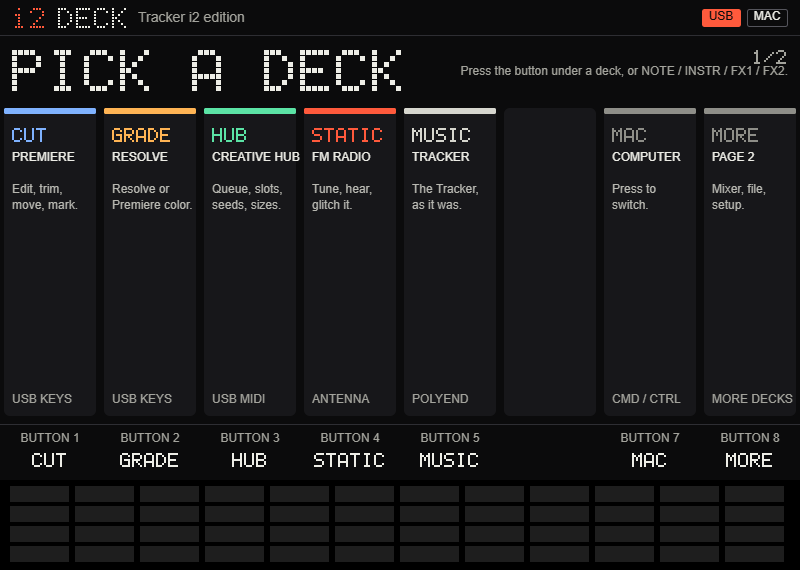
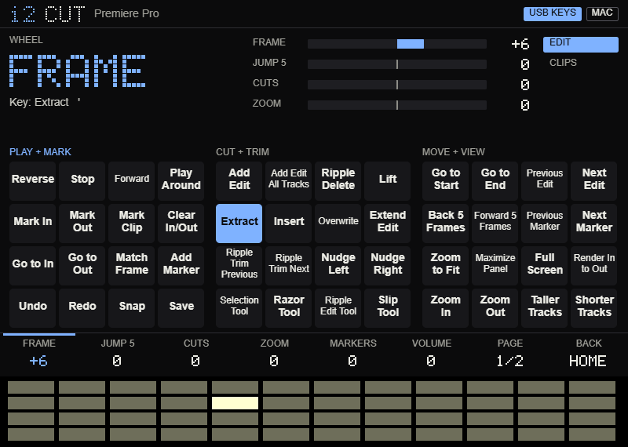

# Tracker i2 edition

Custom firmware for the **original Polyend Tracker** by [i2 interactive](https://i2interactive.com), built on Polyend's open-source [Tracker Community Edition](https://github.com/polyend/tracker-ce).

It adds **i2 DECK**: a new full-screen interface that turns the Tracker into a control surface for video work. Plug it into a Mac or PC over USB-C and the 48 pads, the jog wheel and the screen become a labelled keypad, a multi-function dial and a live display. Nothing is installed on the computer: the Tracker shows up as a standard USB keyboard next to its usual MIDI port. The Tracker itself is still there, one button away, and its File and Config screens are locked behind a button combo.



> **Status: v0.3, not yet tested on hardware.** v0.2 runs on Ian's Tracker, and its USB keys reach Windows over a data-rated USB-C cable. v0.3 adds the Premiere Color Mode side of GRADE, STATIC's glitch section and the lock. It builds for all three Trackers, and every screen below is rendered from the real firmware code on a PC. i2 DECK only appears on the original Tracker (2020). See the [test checklist](#hardware-test-checklist).
>
> **Use a data-rated USB-C cable.** A charge-only cable powers the Tracker, but the deck shows **NO USB** and the computer sees nothing.

## Install

**Step-by-step guide: [INSTALL.md](INSTALL.md)**, from a stock Tracker to i2 DECK, with recovery steps.

The short version:
1. Back up your SD card.
2. Put the official Tracker 1.9.2 and CE 1.0 `.ptf` files from [polyend.com/downloads](https://polyend.com/downloads/) in `Firmware/` as a safety net.
3. Download the newest **polyend-tracker-ce-firmware** artifact from the [Actions tab](https://github.com/i2interactive/tracker-i2-edition/actions/workflows/build.yml). You need to be signed in to GitHub.
4. Copy `PolyendTracker_i2_<version>.ptf` to `Firmware/` without renaming it.
5. On the Tracker, run **Config > Firmware > Firmware update**. From v0.3 on, Config is locked: first open the lock with the [unlock combo](#the-lock) on the i2 DECK home screen.
6. The Tracker restarts into i2 DECK.

## How i2 DECK works

The Tracker starts on the **home screen**. The eight buttons under the screen pick what is above them: a deck, **MUSIC** (the normal Tracker), or the **Mac / Win** switch.

Every deck uses the same layout:

| Part of the screen | What it shows | What you press |
|---|---|---|
| **Key map** (bottom half) | The 48 pads as three 4x4 blocks, each key with a short code | The pad in the same position. Lit pads have a job; a held pad lights up on screen and its full name appears in the live band |
| **Dial strip** (bottom edge) | Jobs for the jog wheel, PAGE and HOME | Screen buttons pick the wheel's job. **Button 8 is HOME in every deck.** In a deck with pages, button 7 turns the page |
| **Live band** (top) | The wheel's current job, the name of the last key pressed, and how far each dial has moved | |

- **Shift** adds Shift to any pad or wheel step.
- **Play, the arrows, Delete, Copy and Insert** send Space, the arrow keys, Backspace, Copy and Paste in the keyboard decks.
- **Any Tracker button** (Pattern, Song, Sample...) opens that Tracker screen straight away. **File and Config are locked** (see [The lock](#the-lock)). In the Tracker's screens, **Config (or File) brings you back to i2 DECK** while locked.
- **Mac or Windows:** button 7 on the home screen. It swaps Cmd for Ctrl and Option for Alt, and is remembered.

### The lock

The Tracker shows only the i2 DECK home screen, its decks and MUSIC (the normal pattern, instrument, sample and song screens). Polyend's **File** (project browser) and **Config** screens are locked:

- In i2 DECK, File and Config do nothing except flash **LOCKED**.
- In the Tracker's own screens, File and Config take you to the i2 DECK home screen, which shows **LOCKED**. This is also the way back to the deck.
- A locked Tracker always starts in i2 DECK (`boot=music` only applies when the lock is off).

**To unlock until the next restart:** in i2 DECK (home screen or any deck), **hold Shift and Rec** (bottom row of the right-hand buttons, next to each other) and press **screen buttons 8, 1, 8** within 3 seconds. The home screen shows **UNLOCKED UNTIL RESTART**, and an UNLOCKED chip stays in the top bar. File, Config and **Config > Firmware > Firmware update** now work. Do the combo again to lock without restarting.

**To turn the lock off for good:** change `lock=on` to `lock=off` in `i2/Deck/settings.txt` on the SD card.

There is no way to get stuck: the combo always works in i2 DECK, `lock=off` on the card always works, and the recessed pinhole recovery on the bottom of the Tracker is in the bootloader, which firmware can't touch (see [INSTALL.md](INSTALL.md#part-7-if-something-goes-wrong)).

### CUT: Premiere Pro



Uses Premiere's **default shortcuts**, so nothing is imported into Premiere. Two pages:

- **EDIT:** shuttle (J K L), in/out marks, add edit, ripple delete, lift/extract, insert/overwrite, trims, nudge, tools, timeline navigation, markers, zoom, track height, render.
- **CLIPS:** clipboard, group/link/enable, speed, gain, subclip, transitions, clip volume, import/export/save, and the panel shortcuts.
- **Wheel:** frame step, 5-frame jump, cut to cut, zoom, marker to marker, clip volume.

### GRADE: DaVinci Resolve or Premiere Color Mode


GRADE is one deck with two apps. **Screen button 6** switches between **RESOLVE** and **PREMIERE**; the lit half of the switch shows which one is live, and the choice is kept in `settings.txt` (`grade=resolve` or `grade=premiere`). Each side has its own key map and wheel jobs, and Mac/Win works on both.

**RESOLVE** uses the colour page's **default shortcuts**: add serial/parallel/layer/outside nodes, add windows, step through nodes, bypass, resets, grab still, wipe, split screen, versions, memories, and copy the grade from one or two clips back. **The wheel grades.** Press **LITE** once to switch on Resolve's printer lights, then pick MASTER, RED, GREEN or BLUE on the dial strip and turn. Each click is one printer point. Resolve has no shortcuts for the colour wheels themselves, so lift/gamma/gain stay on the mouse.


**PREMIERE** drives **Color Mode** (Premiere 27), which has its own keyboard layout, separate from Edit Mode:

- **MODE + VIEW:** jump to Edit, Color or Export mode (Window > Mode, Option/Alt + number), Comparison View (Cmd/Ctrl+3), previous/next clip (Up/Down), accept (Return), Esc, hold to hide the HUD (H), play, undo/redo, markers, plus reference marker, swap sides and split.
- **NUDGE + PLAY:** the arrow keys, which nudge a latched control like printer points, and the bigger Shift steps; J K L.
- **LATCH A CONTROL:** Contrast, Exposure, Temperature, Balance, Saturation, Hue, Lum Shift, Texture, Sharpness, Pivot, Black, Tint, Saturation Shift, Zones, Global, Auto Color.
- **Wheel:** latch a control (pad or click), then NUDGE V / NUDGE H move it. With nothing latched, NUDGE V and CLIPS step through clips.

Adobe has published only a few of Color Mode's default keys. Each line in `i2/Deck/gradepr.txt` is marked **[OK]** (checked in Adobe's docs), **[??]** (a guess: check it) or **[SET]** (no published default: assign the key in Premiere's Keyboard Shortcuts, Color Mode layout, or change the deck). The mode keys and the 16 latch keys need checking. Sources and details: [`tools/i2deck/PREMIERE_COLOR.md`](../tools/i2deck/PREMIERE_COLOR.md).

**No control surface route:** Premiere's built-in surface support (EUCON, Mackie) drives audio mixing and transport. Colour panels such as Tangent go through Tangent's own software. Neither path is open to the Tracker, so GRADE sends keys.

### HUB: i2 Creative Hub / ComfyUI


Sends **USB MIDI** instead of keys: each pad is a note (pad number 0-47, channel = page), and the wheel sends relative control changes 1-7 (65 = up, 63 = down). The labels (queue, interrupt, seed, workflow slots, sizes, quality) are names for those notes.

**One-way for now:** the Creative Hub does not listen for MIDI yet, so this deck does nothing until that side is written. Any app with MIDI learn can use it today.

### STATIC: the FM radio, heard and glitched


The original Tracker has an FM receiver. STATIC tunes it, **plays it** through the Tracker's outputs, and glitches it live. Headphones are the antenna, so keep a headphone cable plugged in.

**TUNER page**
- **Seek and step**, and the wheel tunes (Shift = 10x).
- **Eight station presets.** Shift + a station pad stores the current frequency.
- **Signal meter and scope**, plus the station's name when it broadcasts one.
- **MON** turns the radio sound on and off; the VOLUME dial sets its level (remembered).
- **SEND** turns signal strength into MIDI control change 20 on channel 16, so reception noise can drive a parameter in any MIDI app.
- **REC** opens the Tracker's sample recorder (pick **Radio** as its source) to sample the station.

**GLITCH page** (screen button 7 turns the page). Pads are momentary: hold to glitch, let go to return to the live station.

| Pad | Effect |
|---|---|
| STUT | Stutter: repeats the last note value at the project's tempo (wheel while held: 1/2 to 1/64) |
| 1/4 1/8 1/16 1/32 | Beat repeat at that length |
| CRSH | Bit crush plus sample-rate reduction |
| STOP | Tape stop: the pitch drops to nothing (amount = how fast) |
| SCAN | Hops the tuner around the station, with noise bursts between stations |
| FILT | Resonant low-pass sweep (amount = how closed) |
| FRZ | Freeze: holds a short grain; a latch, press again to let go |
| RSSI | Latch: signal strength closes the filter, so a fading station gets darker |
| KILL | Lets go of FRZ and RSSI |

**Turn the wheel while holding an effect** to set its strength (Shift = big steps). The AMOUNT dial sets the strength of the last effect touched, LENGTH sets the stutter length, and VOLUME sets the radio level. The live band shows each effect's strength, lit while engaged, plus the audio level and signal strength. Station presets and seek are on this page too.

**How the radio is processed:** the Si4703's audio goes through an analog switch into the codec's line input (the same route the sample recorder uses for Radio). The codec streams it into the audio engine with the line-in signal (`i2sStream -> stereoToMono -> mixer`). On the original Tracker that stream now passes through a small processor (`i2glitch::Core`) before the mixer. When nothing is engaged it passes the audio straight through and keeps 3 s of history in SDRAM. When an effect is engaged, it works on a mono mix (the tuner runs in mono) and costs well under 1% of the CPU per audio block. Outside STATIC, the line input goes back to the jack at the project's line-in volume, and the processor stays a pass-through.

### Making your own deck

The first time a deck opens, it is written to the SD card as `i2/Deck/cut.txt`, `grade.txt`, `hub.txt` or `static.txt`. Edit the file on a computer and reopen the deck. No new firmware is needed. Delete the file to get the built-in version back.

```text
DECK CUT
REV 1                          (optional: see below)
APP Premiere Pro
LINK KEYS                      (KEYS, MIDI or RADIO)
COLOR 7FB2FF
PAGE EDIT
BLOCK 1 PLAY + MARK            (blocks 1-3, left to right)
K REV  REVERSE  | J            (next pad in the block: code, name | shortcut)
K CLR  CLEAR IO | OPT+X | CTRL+SHIFT+X     (optional separate Windows shortcut)
K -                            (leave a pad empty)
DIAL 1 FRAME | RIGHT | LEFT    (wheel job: name | clockwise | anticlockwise)
```

- Up to 4 pages, 16 keys per block, 7 dials per page (6 in a deck with more than one page, where button 7 turns the page; in GRADE, button 6 is the app switch). Codes are up to 4 characters, names up to 10.
- GRADE has two files: `grade.txt` (Resolve) and `gradepr.txt` (Premiere).
- **REV:** the built-in decks carry a version. When new firmware brings a newer GRADE or STATIC deck, the old file on the card is kept as `<name>-old.txt` (for example `static-old.txt`) and replaced, and the deck flashes a note. Copy your edits across from the old file. v0.3 does this once for `grade.txt` and `static.txt`.
- **STATIC actions** (instead of a shortcut): `@SEEK+ @SEEK- @STEP+ @STEP- @P1`-`@P8 @SEND @RECORDER @MON`, the glitches `@STUTTER @CRUSH @STOP @SCAN @FILTER @FREEZE @RSSI @KILL`, beat repeats `@R2 @R4 @R8 @R16 @R32 @R64`, and the dial jobs `@TUNE @AMOUNT @LENGTH @VOLUME`.
- **Modifiers:** `CMD` (Cmd on Mac, Ctrl on Windows), `CTRL`, `SHIFT`, `OPT` or `ALT`, `WIN`.
- **Keys:** A-Z, 0-9, F1-F24, SPACE, ENTER, ESC, TAB, BKSP, DEL, INS, HOME, END, PGUP, PGDN, UP, DOWN, LEFT, RIGHT, BACKSLASH, the symbols `- = [ ] ; ' , . /` and the grave accent, and the number pad as KP0-KP9, KPPLUS, KPMINUS, KPENTER.

### Settings

`i2/Deck/settings.txt` on the SD card, written by the Tracker:

```text
os=mac          mac or win
boot=deck       deck or music (music only works with lock=off)
lock=on         on or off: the File / Config lock
grade=resolve   resolve or premiere: GRADE's app
freq=981        STATIC's station, in 100 kHz
vol=80          STATIC's radio volume, 0-100
p1=885 ... p8=1079   station presets
```

### Hardware test checklist

v0.2 (passed on Ian's Tracker, Nov 14): boots to i2 DECK, USB keys reach Windows over a data-rated cable.

v0.3:
1. **Update and lock.** After flashing, the Tracker boots to i2 DECK. Press Config and File: the screen flashes **LOCKED**, nothing opens. MUSIC (button 5) opens the Tracker; Pattern, Song and Sample screens work; File and Config there bring you back to the i2 DECK home screen, which says LOCKED.
2. **Unlock combo.** On the home screen, hold Shift + Rec and press screen buttons 8, 1, 8. "UNLOCKED UNTIL RESTART" appears and an UNLOCKED chip shows in the top bar. Config opens, including Config > Firmware. Repeat the combo: LOCKED again. Restart: locked again.
3. **lock=off.** Put `lock=off` in `settings.txt`: File and Config open straight away. Put `lock=on` back.
4. **GRADE switch.** In GRADE, button 6 switches RESOLVE / PREMIERE, the switch on screen follows, and the choice survives a restart. Resolve: LITE, then MASTER / RED on the wheel move the image (as in v0.2).
5. **Premiere Color Mode.** In Premiere 27, open a sequence in Color: PREV / NEXT and the CLIPS dial step clips; CMPR toggles Comparison View; click a control to latch it, then NUDGE V / H move it and OK accepts; HUD hides the HUD while held. Check EDIT / COLR / EXPT against Window > Mode, then assign the LATCH keys (see `tools/i2deck/PREMIERE_COLOR.md`) and try a few.
6. **Deck upgrade.** If the card has v0.2's `grade.txt` / `static.txt`, opening GRADE or STATIC flashes "NEW DECK: OLD ONE SAVED AS -OLD", and `grade-old.txt` / `static-old.txt` appear on the card.
7. **STATIC sound.** With headphones in, open STATIC: the station is audible. VOLUME changes the level; MON mutes and unmutes. If it's too quiet, raise **Gain** for Radio in the sample recorder (it's saved with the project), then reopen STATIC. Leave STATIC and play a project: the line input behaves as before (no radio, normal line-in volume).
8. **GLITCH.** Page 2: hold each effect pad (STUT, CRSH, STOP, SCAN, FILT) and let go; each one returns cleanly to the live station. The repeat pads lock to the project tempo. FRZ latches; RSSI darkens the sound as the signal drops (move the cable); KILL clears both. Turn the wheel while holding an effect. Listen for clicks, dropouts or a stuck effect, and check the Tracker still responds smoothly during SCAN (tuning blocks briefly).
9. **Everything from v0.2 still works:** CUT in Premiere, HUB MIDI, STATIC seek / presets / SEND / REC, Mac/Win switch, settings survive a restart.

### Testing on a computer

`tools/i2deck/host/` runs the firmware's own interface code on a PC with scripted input. It renders the screens to PNG, logs every key, note and radio command, fails if a key is left held, and checks each layer and the whole frame against the display chip's limits.

```sh
sh tools/i2deck/host/run.sh        # needs g++, Python 3 and Pillow; output in tools/i2deck/host/out/
```

## Roadmap

- **Creative Hub:** make the Hub listen to the HUB deck (Web MIDI), then send state back to the Tracker's screen
- **GRADE:** fill in Premiere Color Mode's real latch keys once checked; a small helper for true lift/gamma/gain control
- **STATIC:** record the glitched output straight into a sample; per-effect presets
- **Decks:** pad + wheel combos, more decks, a deck picker for user files
- **i2 Arcade:** the KAGEMORI ports from v0.1 are parked in [`shelved/`](../shelved/) and can come back as a deck

## Where the i2 code lives

| Path | What |
|---|---|
| [`core/interface/i2Deck/i2DeckApp.*`](../core/interface/i2Deck/) | The interface: screens, navigation, deck file parser. No Tracker dependencies |
| [`core/interface/i2Deck/i2DeckDecks.cpp`](../core/interface/i2Deck/i2DeckDecks.cpp) | The built-in decks, as text (GRADE has a Resolve and a Premiere file) |
| [`core/interface/i2Deck/i2Glitch.*`](../core/interface/i2Deck/) | STATIC's glitch processor (no Tracker dependencies; tested by the harness) |
| [`core/AudioEngine/AudioEffectI2Glitch.*`](../core/AudioEngine/) | Puts the glitch processor in the line-in stream (`AudioInput`, `audioEngine::connectInputToMixer`). Original Tracker only |
| [`core/interface/core/interface.cpp`](../core/interface/core/interface.cpp) | The lock: `switchModuleByButton` sends File and Config to i2 DECK while locked |
| [`tools/i2deck/PREMIERE_COLOR.md`](../tools/i2deck/PREMIERE_COLOR.md) | Research notes: Premiere Color Mode shortcuts and control surfaces |
| [`core/interface/i2Deck/fI2Deck.cpp`](../core/interface/i2Deck/fI2Deck.cpp) | The Tracker module: input, USB keyboard, MIDI, radio, SD card |
| [`core/interface/i2Deck/i2Canvas.*`](../core/interface/i2Deck/) | Drawing on the FT812 display chip |
| [`core/interface/i2Deck/i2DotFont.*`](../core/interface/i2Deck/) | The 5x7 dot-matrix face, generated at start-up in three sizes |
| [`tools/i2deck/host/`](../tools/i2deck/host/) | The PC test harness |
| [`shelved/`](../shelved/) | v0.1 Controller mode and i2 Arcade. Not built |
| [`platforms/mk66/source/UsbKeyboardImpl.*`](../platforms/mk66/source/) | USB keyboard driver for the original Tracker |
| [`platforms/mk66/3rdparty/teensy_core/usb_desc.h`](../platforms/mk66/3rdparty/teensy_core/usb_desc.h) | USB layout. Keyboard is interface 3, RawHID moves to 4. Build with `-DI2_NO_USB_KEYBOARD` for stock |
| [`core/include/Platform.h`](../core/include/Platform.h) | `UsbKeyboard` interface and the radio's signal strength |
| [`core/libs/NewDisplay/display.cpp`](../core/libs/NewDisplay/display.cpp) | Loads the dot-matrix fonts next to the Tracker's own |
| [`.github/workflows/build.yml`](workflows/build.yml) | CI. Builds are named `i2_<commit>` |

## Hardware notes: original Tracker (MK66)

| Part | What it is | Notes |
|---|---|---|
| CPU | NXP Kinetis MK66FX1M0, Cortex-M4F, 180 MHz | About ⅓ the speed of Tracker+ / Mini |
| Flash | 1 MB | New code has to stay lean. The CI log prints the size of every build |
| RAM | 256 KB internal, about 87 KB free | |
| SDRAM | 16 MB, about 1.1 MB free | i2 DECK borrows the shared 768 KB scratch area; STATIC's glitch history takes 256 KB of its own |
| Display | 7" 800×480, FTDI FT812 | 65 display controls, 8 KB of display memory each |
| Input | 48 backlit pads (4×12), 33 buttons, jog wheel | Pad lights are one color, brightness only |
| Audio | SGTL5000 codec, mono line in, mic in, stereo out | Mono samples on this model |
| Radio | Si4703 FM **receiver** with RDS | Receive only. The headphone cable is the antenna. Its audio reaches the codec's line input through an analog switch |
| I/O | MIDI in/out (minijack), USB-C MIDI, microSD | No Wi-Fi, Bluetooth or USB audio |

## Staying in sync with Polyend

This repo is a **fork**: a copy of Polyend's repo that keeps a link back to it. When Polyend pushes updates, GitHub shows "This branch is N commits behind polyend/tracker-ce" on the repo page. Click **Sync fork** to pull them in. If Polyend changed a file that i2 also changed, GitHub asks for the conflict to be fixed first.

The i2 changes stay in their own files where possible, and this README lives in `.github/` so Polyend's `README.md` never conflicts.

## Build

GitHub Actions builds all three models on every push to `main` and on every pull request to `main`. To build locally, install GNU Arm Embedded Toolchain 10.3-2021.10 and run `make original`. The file appears as `build/PolyendTracker_*.ptf`. Polyend's full developer docs are in [`README.md`](../README.md) and [`docs/`](../docs/).

## License

MIT, inherited from Polyend's Tracker CE, plus Polyend's restriction on selling a wholesale commercial clone of the full Tracker firmware. The precompiled `synth/lib/*.a` files have their own license. See [`LICENSE`](../LICENSE).

Not affiliated with or endorsed by Polyend.

## Contributing upstream

Polyend's PR check rejects AI `Co-authored-by` trailers. Strip them before opening a PR to `polyend/tracker-ce`.
